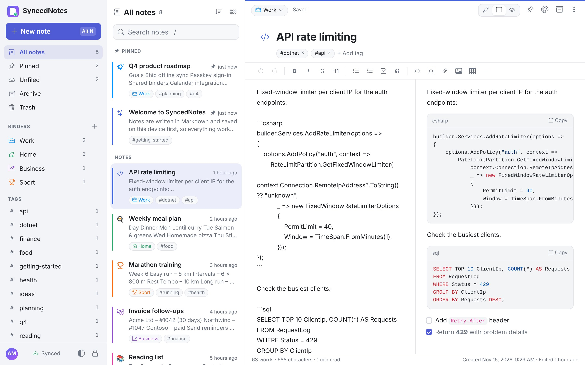
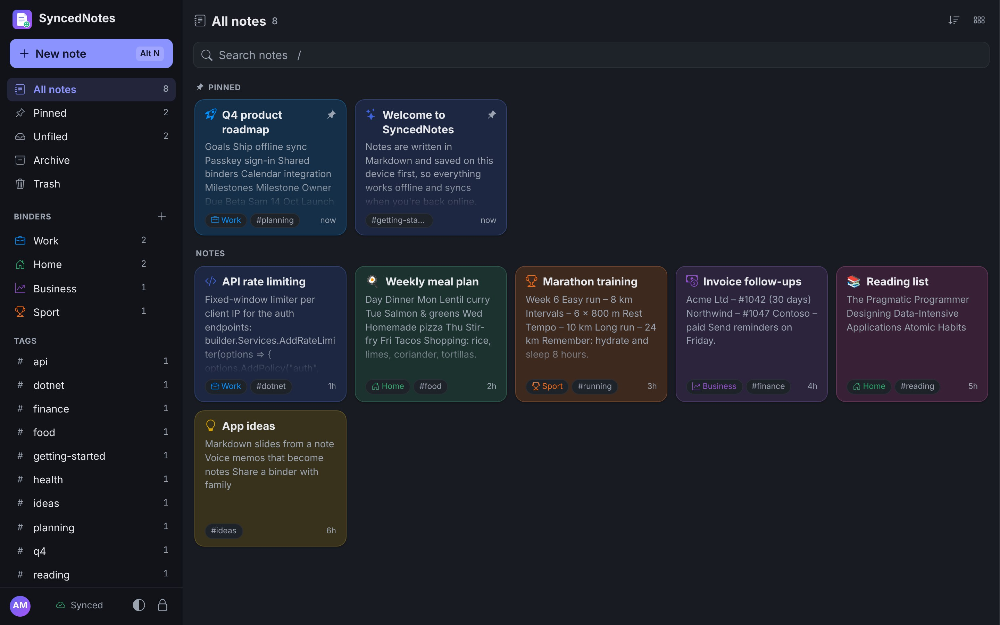
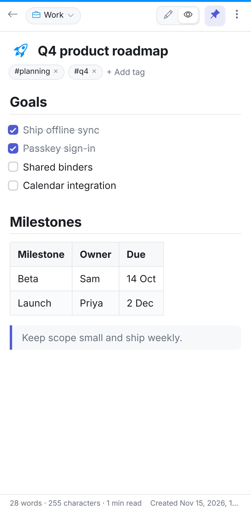

# SyncedNotes

Offline-first Markdown notes as an installable web app (PWA), built with **ASP.NET Core 10**, **Entity Framework Core** and **SQLite**, with **Bootstrap 5** and **jQuery** on the front end.
Sign in with a **passkey**, write in Markdown with a live preview, and keep working without a connection. Everything syncs when you're back online.



<p>
  
  
</p>

## Features

**Writing**
- Notes are stored as **Markdown**. The editor has edit, split and preview modes (<kbd>Ctrl</kbd>+<kbd>E</kbd>), a formatting toolbar, and smart lists: <kbd>Enter</kbd> continues a list and <kbd>Tab</kbd> indents.
- GitHub-flavoured Markdown: tables, task lists you can tick in the preview, and wiki links such as `[[Another note]]`.
- **Code blocks with syntax highlighting** (highlight.js, about 40 languages including C#, SQL, PowerShell, TypeScript and Python) and a copy button.
- **Undo and redo** that group typing by word. Note actions (archive, move, trash, pin, recolour) can be undone with <kbd>Ctrl</kbd>+<kbd>Z</kbd> or the toast's Undo button.
- **Paste or drop images** into a note. They're stored on the device and uploaded on the next sync.

**Organising**
- **Binders** for categories. Work, Home, Business and Sport are created for you, and each binder can have its own colour and icon.
- **Tags**, **pinned notes**, an **archive**, and a **trash** that keeps notes for 30 days.
- **Note colours and icons**, chosen from Bootstrap Icons or emoji.
- **Sort** by date modified, date created, title or a custom drag-and-drop order. Show notes as a **list or cards**.
- **Drag and drop**:
  - Reorder notes and binders.
  - Drop notes onto a binder, tag, Pinned, Archive or Trash.
  - Drop `.md` files to import them, or images into the editor.
- Search titles, content and tags (`#tag` filters by tag), with matches highlighted.

**Offline and sync**
- Works offline from the first visit: a service worker caches the app and IndexedDB stores your notes.
- Sync runs in the background, including Background Sync once the tab is closed (Chromium browsers).
- Field-level merging means edits to different properties of the same note on two devices are combined. If both devices edit the text, nothing is lost: the second version is saved as a separate "conflicted copy".
- **Light, dark and system themes.** The theme is applied before the page paints, remembered on the device and synced to your other devices.
- **Responsive layout**: three panes on desktop, two on tablets, one on phones.

**Installable app (PWA)**
- Install it on Windows, macOS, Android, iOS or ChromeOS. It includes an app icon (including maskable icons), app shortcuts (New note, Search), and screenshots for the install dialog.
- Appears in the system **share sheet** and can be set to **open `.md` files**.
- Asks before updating to a new version.

**Security**
- **Passkey sign-in** (WebAuthn) using the passkey support built into ASP.NET Core Identity in .NET 10. There are no passwords to leak.
- Account recovery with one-time **recovery codes** (stored hashed) plus a server command-line tool.
- **App lock** hides your notes after a period of inactivity, when you switch away, or when the app is opened. Unlock with your passkey or an optional PIN.
  - The lock is **enforced by the server**: a locked session gets HTTP 423 from every notes API.
  - It also works offline.
- Built for one person, but every account only ever sees its own notes. By default only the first account can register.
- Other protections:
  - A strict Content Security Policy with no inline scripts.
  - CSRF protection on every API.
  - Rate-limited sign-in, unlock and integration endpoints.
  - Hashed API tokens.
  - Quick-add links protected by Fetch Metadata.

**Keyboard and integrations**
- A **command palette** (<kbd>Ctrl</kbd>+<kbd>K</kbd>) for jumping to notes, tags (`#`), binders (`@`) and every command (`>`). Press <kbd>?</kbd> to see all keyboard shortcuts.
- **Microsoft PowerToys Command Palette**: add and search notes from <kbd>Win</kbd>+<kbd>Alt</kbd>+<kbd>Space</kbd>. Use Bookmarks with no installation, or the optional native extension in [`tools/PowerToys`](tools/PowerToys/README.md).
- A quick-add URL (`/new?title=…&text=…&tags=…&binder=…`), a bookmarklet, and a token-authenticated API.
- Export every note as a `.zip` of Markdown files with YAML front matter and images. Import `.md` and `.txt` files.

## Getting started

Requirements: the [.NET 10 SDK](https://dotnet.microsoft.com/download/dotnet/10.0).

```bash
dotnet dev-certs https --trust
```

```bash
dotnet run --project SyncedNotes --launch-profile https
```

Open <https://localhost:7022>. On the first visit you create your account: choose a username, then create a passkey with Windows Hello, Touch ID or Face ID, your phone, or a security key. Save the recovery codes it shows you.

> Passkeys only work over **HTTPS** or on `localhost`, and they're tied to the host name. Decide on the final domain before you register (see `Passkeys:ServerDomain` below).

The database is created and migrated automatically in `SyncedNotes/App_Data/syncednotes.db`.

## Configuration

Settings live in `appsettings.json` and can be overridden with environment variables (`Section__Key`):

| Setting | Default | Description |
| --- | --- | --- |
| `DataDirectory` | `./App_Data` | Folder for the SQLite database. Notes, images, accounts and data-protection keys are all in one file. |
| `ConnectionStrings:Default` | *(empty)* | Full SQLite connection string. Overrides `DataDirectory`. |
| `Auth:Registration` | `FirstUserOnly` | `FirstUserOnly`, `Open` (anyone can create an account; each sees only their own notes) or `Closed`. |
| `Auth:SessionDays` | `60` | How long a device stays signed in without being used (sliding). |
| `Passkeys:ServerDomain` | *(request host)* | The WebAuthn relying-party ID. Set this if the app is reachable under several host names. |
| `DisableBackgroundCleanup` | `false` | Turns off the job that empties trash older than 30 days and removes unused images. |

## Deploying

```bash
dotnet publish SyncedNotes -c Release -o ./publish
```

- Run it behind a reverse proxy that terminates HTTPS, such as Caddy, nginx, IIS or Azure App Service. Behind a proxy:
  - Set `ASPNETCORE_FORWARDEDHEADERS_ENABLED=true` so the app sees the original scheme and the visitor's IP address. Sign-in attempts are rate-limited per IP address, so without this setting every visitor shares the proxy's address and its limit.
  - Pass the original `Host` header through. Caddy does this by default; in nginx, add `proxy_set_header Host $host;`. Passkeys are tied to the domain, and the links that the quick-add API returns use it too.
- Put `DataDirectory` on persistent storage. Notes, images and settings all live in the one SQLite database. While the app is running, back it up with `sqlite3 syncednotes.db ".backup backup.db"`. With the app stopped, you can copy `syncednotes.db`, plus `syncednotes.db-wal` if it exists.
- The data-protection keys that protect sign-in cookies are stored in the database, so restarts and redeploys don't sign anyone out.

### Lost every passkey and recovery code?

On the server, run:

```bash
dotnet SyncedNotes.dll recovery-codes <username>
```

This prints a fresh set of recovery codes. Sign in at `/Account/Recover`, then add a new passkey under **Settings → Security**.

## Using SyncedNotes

### Keyboard shortcuts

| Action | Shortcut |
| --- | --- |
| Command palette | <kbd>Ctrl</kbd>+<kbd>K</kbd> (or <kbd>Ctrl</kbd>+<kbd>Shift</kbd>+<kbd>P</kbd> for commands) |
| New note | <kbd>Alt</kbd>+<kbd>N</kbd> |
| Search | <kbd>/</kbd> or <kbd>Ctrl</kbd>+<kbd>Shift</kbd>+<kbd>F</kbd> |
| Save and sync now | <kbd>Ctrl</kbd>+<kbd>S</kbd> |
| Edit / split / preview | <kbd>Ctrl</kbd>+<kbd>E</kbd> |
| Pin, archive, trash | <kbd>Alt</kbd>+<kbd>P</kbd>, <kbd>Alt</kbd>+<kbd>A</kbd>, <kbd>Alt</kbd>+<kbd>Delete</kbd> |
| Next / previous note | <kbd>Alt</kbd>+<kbd>↓</kbd> / <kbd>Alt</kbd>+<kbd>↑</kbd> |
| List or cards, theme | <kbd>Alt</kbd>+<kbd>V</kbd>, <kbd>Alt</kbd>+<kbd>T</kbd> |
| Sidebar, focus mode | <kbd>Ctrl</kbd>+<kbd>\\</kbd>, <kbd>Ctrl</kbd>+<kbd>Shift</kbd>+<kbd>\\</kbd> |
| Lock the app | <kbd>Ctrl</kbd>+<kbd>Shift</kbd>+<kbd>L</kbd> |
| Settings | <kbd>Ctrl</kbd>+<kbd>,</kbd> |
| Undo / redo (text, or the last note action when not typing) | <kbd>Ctrl</kbd>+<kbd>Z</kbd> / <kbd>Ctrl</kbd>+<kbd>Y</kbd> |
| Bold, italic, strikethrough, link, inline code | <kbd>Ctrl</kbd>+<kbd>B</kbd>, <kbd>Ctrl</kbd>+<kbd>I</kbd>, <kbd>Ctrl</kbd>+<kbd>Shift</kbd>+<kbd>X</kbd>, <kbd>Ctrl</kbd>+<kbd>K</kbd>, <kbd>Ctrl</kbd>+<kbd>`</kbd> |
| Numbered, bulleted, checklist | <kbd>Ctrl</kbd>+<kbd>Shift</kbd>+<kbd>7</kbd> / <kbd>8</kbd> / <kbd>9</kbd> |

On macOS, use <kbd>⌘</kbd> instead of <kbd>Ctrl</kbd>, and <kbd>⌃</kbd><kbd>⌥</kbd> instead of <kbd>Alt</kbd>. Press <kbd>?</kbd> in the app for the full list.

### Offline and sync

Every change is written to the device first (IndexedDB) and marked as pending. Changes are pushed when you're online: shortly after you stop typing, every minute, whenever the app comes back into view, and through Background Sync after the app is closed. The status at the bottom of the sidebar shows "Synced", "N to sync" or "Offline". Click it, or press <kbd>Ctrl</kbd>+<kbd>S</kbd>, to sync immediately.

How changes from two devices are combined:
- If two devices change **different things** in the same note (for example, one pins it while the other edits its text), both changes are kept.
- If both devices change the **text**, the version that synced first stays. The other is saved as *"Title (conflicted copy …)"*, and you get a toast with a link to it.

### App lock

Turn it on under **Settings → Security**:
- **When it locks**: after 1 minute to 4 hours of inactivity, as soon as you leave the app, or never automatically. You can also make it lock every time the app is opened.
- **Unlock**: with a passkey or an optional 4–12 digit PIN. After 5 wrong PINs, only a passkey works.
- **Server enforcement**: the lock is stored in the encrypted sign-in cookie, so it can't be cleared from the browser's developer tools. While locked, the server refuses to send any notes (HTTP 423).

### PowerToys Command Palette

There are two ways to connect it. Both are described in detail in [`tools/PowerToys/README.md`](tools/PowerToys/README.md).

1. **No install.** Command Palette Bookmarks support `{placeholders}`. Add bookmarks for these URLs; the exact URLs for your server are listed under **Settings → Integrations**:
   - New note: `https://your-server/new?text={note}`
   - New note with title: `https://your-server/new?title={title}&text={note}`
   - Search: `https://your-server/?q={search}`
2. **Native extension.** It adds notes without opening a browser, searches as you type, and adds an "Add note to SyncedNotes" fallback. Build it with Visual Studio, then paste an API token from **Settings → Integrations**.

## Project layout

```
SyncedNotes/
  Program.cs              Composition root: EF Core/SQLite, Identity + passkeys, cookies, rate limits, pipeline
  Data/                   Entities, AppDbContext, EF Core migrations
  Auth/                   Passkey sign-in, app-lock claim, recovery codes, API tokens, registration policy
  Endpoints/              Minimal APIs: auth, session/lock, account, sync, attachments, export, quick API
  Sync/                   Sync protocol models, merge rules (SyncService), validation
  Services/               Seeding, export (.zip), cleanup job, service-worker generator
  Infrastructure/         CSRF/lock filters, security headers, quick-add link guard
  Pages/                  Razor Pages: app shell, sign-in, register, recover, offline
  ServiceWorker/sw.js     Service worker (served from /sw.js with a content hash)
  wwwroot/js/core/        util, IndexedDB, sync engine and WebAuthn helpers (shared with the service worker)
  wwwroot/js/app/         jQuery UI modules: store, editor, list, sidebar, commands/palette, lock, settings, PWA
tests/SyncedNotes.Tests/  xUnit integration tests (WebApplicationFactory)
tests/e2e/                End-to-end tests (Playwright + virtual passkey authenticator) and screenshot script
tools/PowerToys/          PowerToys Command Palette extension and setup guide
tools/icons/              Icon sources and the script that renders the PNG/ICO files
```

### How sync works

- **Change sequence.** Each user has a change sequence. Every write to a note, binder or preference gets the next number (`Rev`).
- **Pulling changes.** A client asks for everything after its cursor (`GET /api/sync?since=N`). The server reads the high-water mark before it queries, so concurrent writes are never skipped.
- **Pushing changes.** A client pushes the records it changed (`POST /api/sync`). Each record carries the revision it was based on and the names of the fields it changed.
- **Merging.** The server applies only those fields, so concurrent edits merge field by field. It detects real text conflicts with a separate `ContentRev`.
- **Deletes and IDs.** Deletes become tombstones so every device learns about them. IDs are GUIDs generated on the device, which is what lets you create notes offline.

## Development and tests

```bash
dotnet build
```

```bash
dotnet test
```

`dotnet test` runs the integration tests in `tests/SyncedNotes.Tests`. They exercise the HTTP API in an in-memory test server with a real SQLite database. They cover sign-in, recovery codes, app lock, sync and conflicts, images, export, API tokens, CSRF and rate limits, and checks that one account can't see another's notes.

End-to-end tests run against a real server in Chromium, with a virtual passkey authenticator.

1. Start a server with registration open and an empty data folder:

   ```bash
   Auth__Registration=Open DataDirectory=/tmp/sn-e2e dotnet run --project SyncedNotes --urls http://localhost:5177
   ```

2. In another terminal, install the test tools:

   ```bash
   cd tests/e2e && npm install && npx playwright install chromium
   ```

3. Run the tests:

   ```bash
   npm test
   ```

4. Optionally, regenerate the README and install-dialog screenshots:

   ```bash
   node screenshots.mjs
   ```

To regenerate the icons after editing `SyncedNotes/wwwroot/icons/icon.svg` or `tools/icons/maskable.svg`, run `node tools/icons/render-icons.js` (this needs the `playwright` package).

## Third-party components

All front-end libraries are served from `wwwroot/lib`, with their licence files, so the app never depends on a CDN and works offline:

| Library | Licence |
| --- | --- |
| Bootstrap 5.3 and Bootstrap Icons | MIT |
| jQuery 4 | MIT |
| marked | MIT |
| DOMPurify | Apache-2.0 / MPL-2.0 |
| highlight.js | BSD-3-Clause |
| SortableJS | MIT |
